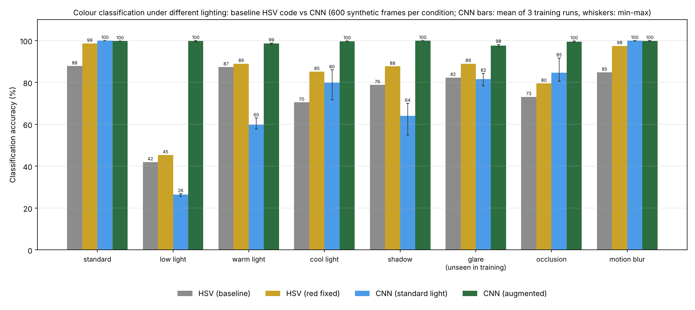
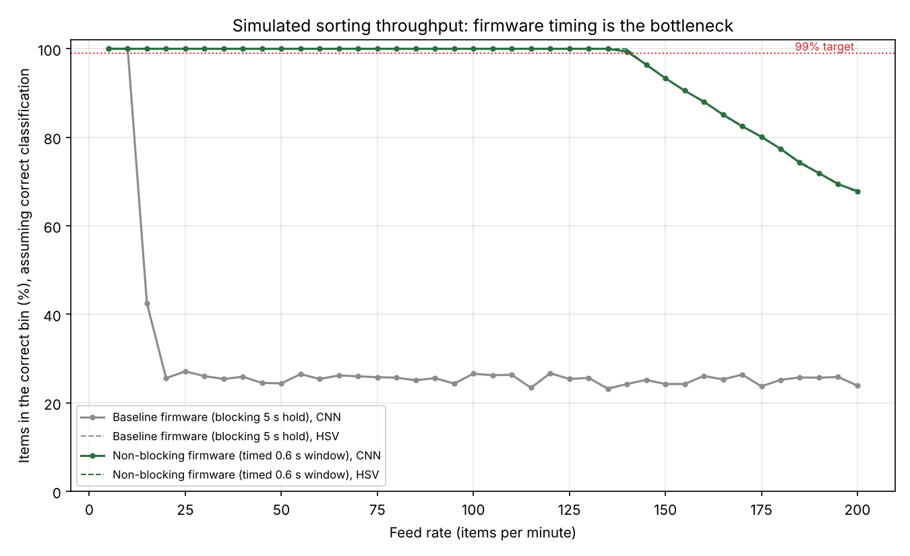

# Conveyor Belt Colour Sorting: HSV thresholds vs a CNN

A camera watches objects on a conveyor belt and decides each object's colour, and an Arduino swings a servo to push the object into the red, green or blue bin. Anything else continues to the end of the belt.

This repository contains:

- **A working sorter** (`baseline/`): a Python program that classifies webcam frames with OpenCV HSV colour thresholds and sends commands over serial, and the Arduino firmware that drives the servos.
- **A CNN classifier** (`sim/cnn.py`) that replaces the hand-tuned thresholds.
- **A lighting study** comparing the two methods on synthetic camera frames under eight lighting and camera conditions.
- **A throughput simulation** of the belt and diverters, plus a non-blocking firmware design (`arduino/`) that removes the baseline firmware's speed limit.

The study uses **synthetic camera frames and a simulated conveyor**. Its results show how the methods compare and why; they are not measurements of physical hardware. See [Limitations](#limitations).

## How the sorter works

| Component | Role |
|---|---|
| `baseline/sorter.py` | reads the webcam; resizes each frame to 100×100 and blurs it; checks HSV ranges for red, green and blue; a colour counts if it covers over 1000 of the 10,000 pixels; sends `R`, `G` or `B` to the Arduino over serial at 9600 baud |
| `baseline/sketch_dec23a.ino` | Arduino firmware: on `R`, `G` or `B` it swings that servo (pins 2, 5, 6) to 90° for 5 s, then back to 0° |
| `arduino/sorter_nonblocking.ino` | alternative firmware: same protocol, but no blocking delay, and each diverter opens only while its own object passes |

## Lighting study: HSV thresholds vs a CNN

### Setup

`sim/scene.py` draws 320×240 camera frames of one object on a dark belt. Objects are circles, rectangles, triangles or irregular blobs in red, green, blue, or an "other" colour (orange, yellow, purple, pink, white, black or brown). Each test set applies one condition:

| Condition | What changes |
|---|---|
| standard | normal brightness, small variations |
| low light | about 30–40% of normal brightness, more sensor noise |
| warm / cool light | strong yellow (tungsten) or blue casts |
| shadow | a soft-edged shadow across the object |
| glare | a bright specular highlight on the object |
| occlusion | 35–55% of the object covered |
| motion blur | strong horizontal blur from belt movement |

Four classifiers were compared on 600 frames per condition (150 per class):

- **HSV (baseline):** `detect_color()` from `baseline/sorter.py`. `baseline/colour_detect.py` compiles that exact function out of the file, so the code under test is the sorter's own code, not a copy.
- **HSV (red fixed):** the same function with one bug fixed (see below).
- **CNN (standard light):** a small CNN (4 convolution blocks, about 60k parameters, `sim/cnn.py`) trained on 8,000 standard-lighting frames.
- **CNN (augmented):** the same network trained on 8,000 frames with randomised brightness, colour casts, shadows, occlusion and blur. **Glare is deliberately left out of its training**, so the glare test measures generalisation to an unseen condition.

All settings (data sizes, network, 10 epochs, keeping the epoch with the best validation accuracy) were fixed before any test results were seen. Each CNN is trained three times with different random seeds. Validation data comes from each model's own training distribution, never from the test conditions.

### A bug in the baseline red range

OpenCV's hue scale runs 0–179, and red lies at both ends. The baseline code only checks hues 0–10, so crimson and slightly bluish reds (hue 170–179) are never detected as red. In the standard-lighting test this alone caused 68 of 150 red objects to be missed. *HSV (red fixed)* adds the second range and changes nothing else, which separates the bug from the method's real weakness, lighting.

### Results



CNN results are the mean of three training runs with different random seeds, with the range in brackets.

| Condition | HSV (baseline) | HSV (red fixed) | CNN (standard light) | CNN (augmented) |
|---|---|---|---|---|
| standard | 87.8% | 98.7% | 100.0% (100.0–100.0) | 99.8% (99.8–99.8) |
| low light | 42.0% | 45.3% | 26.4% (25.7–26.8) | 99.8% (99.3–100.0) |
| warm light | 87.3% | 89.0% | 59.8% (57.8–63.0) | 98.6% (98.2–98.8) |
| cool light | 70.5% | 85.2% | 79.8% (71.7–86.0) | 99.7% (99.7–99.8) |
| shadow | 78.8% | 87.7% | 64.1% (54.8–70.0) | 100.0% (100.0–100.0) |
| glare (unseen in training) | 82.3% | 89.0% | 81.7% (78.3–84.3) | 97.6% (97.2–98.2) |
| occlusion | 73.2% | 79.5% | 84.6% (80.5–91.7) | 99.6% (99.3–99.8) |
| motion blur | 84.8% | 97.5% | 99.9% (99.8–100.0) | 99.8% (99.7–100.0) |
| **mean** | **75.9%** | **84.0%** | **74.5%** (71.9–76.8) | **99.4%** (99.3–99.4) |

What happens when each method is wrong, over all conditions (and all CNN runs) combined:

| Method | Correct | Wrong bin | Missed (coloured → end of belt) | False sort (other → a bin) |
|---|---|---|---|---|
| HSV (baseline) | 75.9% | 1.0% | 21.0% | 2.2% |
| HSV (red fixed) | 84.0% | 0.5% | 13.1% | 2.4% |
| CNN (standard light) | 74.5% | 0.9% | 22.9% | 1.7% |
| CNN (augmented) | 99.4% | 0.0% | 0.3% | 0.3% |

### Findings

- **A CNN is not automatically more robust.** Trained only on standard lighting, the CNN was perfect in standard light but averaged 74.5% overall, slightly below the HSV baseline's 75.9%. In low light it scored 26%, worse than the HSV rule's 42%, because it labelled almost every dim object "other". The network learned the brightness of its training data, just as the thresholds have it built in.
- **Its behaviour outside the training data is also unpredictable.** All three standard-light runs scored 100% on validation, yet on unfamiliar conditions they differed by up to 15 points (shadow: 55–70%; occlusion: 81–92%). Validation accuracy on familiar data says little about robustness.
- **Training data is what fixes lighting.** The same network trained on varied lighting stayed at 97–100% in every condition and every run, including glare (97.6%), which it never saw.
- **HSV fails safe.** Most of its errors are *missed* objects that run to the end of the belt rather than objects put in the wrong bin (1.0%). That suits a sorter: a missed object can be fed through again, but a wrong bin contaminates a batch.
- **Low light is the HSV method's hard limit.** Even with the red fix it gets 45%, because dimmed colours fall below the brightness floor (V ≥ 70) in its HSV ranges.

## Throughput simulation

`sim/conveyor.py` simulates the belt after classification. Three diverters sit 2.0, 2.5 and 3.0 s downstream of the camera, items arrive with ±30% random spacing, and an open diverter pushes whatever passes it into its bin. Classification is assumed correct here, to isolate the mechanics.



- **Classification is not the bottleneck.** On a laptop CPU the HSV code takes about 0.2 ms per frame and the CNN about 3 ms, both negligible next to belt timings.
- **The baseline firmware's 5-second hold is.** `delay(5000)` keeps a diverter open for 5 s and blocks the board meanwhile, so once items are closer than about 5 s apart, an open diverter starts pushing the *next* item into the wrong bin. In this model the baseline firmware stays above 99% correct only up to **about 10 items per minute**.
- **The non-blocking firmware removes that limit.** `arduino/sorter_nonblocking.ino` queues each command and opens the diverter for 0.6 s, centred on when that item is due. In the model it stays above 99% correct up to about 140 items per minute. That figure follows directly from the assumed 0.6 s window and item spacing; real hardware would need its own timings measured.

## Limitations

- **Synthetic frames are much easier than a real camera.** The objects are flat-coloured, simply shaded shapes on a clean belt, and the test conditions come from the same generator as the augmented training data. The 99.4% for the augmented CNN is therefore an upper bound that would not carry over to real images. Glare, held out of training, is the only evidence of generalisation to something new.
- **Several modelling choices affect the absolute numbers:** which reds count as red, how dark "low light" is, and how large objects appear. They are fixed and documented in `sim/scene.py`. The relative findings (the red-range bug, the standard-trained CNN failing in low light, augmentation fixing it, firmware timing limiting speed) do not depend on the exact values.
- **The conveyor model's timings are assumptions,** not measurements from hardware.
- **The non-blocking firmware has not been tested on hardware.**
- **Next step:** photograph real objects on the belt under several lighting set-ups, fine-tune the CNN on them, and measure accuracy and speed on hardware.

## Running it

```bash
pip install -r requirements.txt
python tests/test_all.py      # checks, including that the code under test is sorter.py's own detector
python sim/evaluate.py        # data generation, training, evaluation (about 10 minutes on CPU)
python sim/conveyor.py        # throughput simulation (uses the trained CNN for timing)
```

To run the sorter on hardware: upload `baseline/sketch_dec23a.ino` (or `arduino/sorter_nonblocking.ino`) to the Arduino, set the serial port in `baseline/sorter.py` (currently `COM4`), and run `python baseline/sorter.py` (needs `opencv-python` and `pyserial`).

## Files

| Path | What it is |
|---|---|
| `baseline/sorter.py` | sorter program: webcam, HSV colour detection, serial commands |
| `baseline/sketch_dec23a.ino` | Arduino firmware (blocking 5 s hold) |
| `baseline/colour_detect.py` | loads `detect_color()` from `sorter.py` for testing, without opening the camera or serial port |
| `sim/scene.py` | synthetic frame generator and lighting conditions |
| `sim/hsv_fixed.py` | HSV detector with the red-range fix |
| `sim/cnn.py` | CNN model and training loop |
| `sim/evaluate.py` | trains both CNNs and evaluates all four methods |
| `sim/conveyor.py` | belt and diverter timing simulation |
| `arduino/sorter_nonblocking.ino` | non-blocking firmware (untested on hardware) |
| `models/` | trained CNN weights (first training run of each) |
| `classification_results.csv`, `throughput_results.csv` | raw results |
| `tests/test_all.py` | tests |
